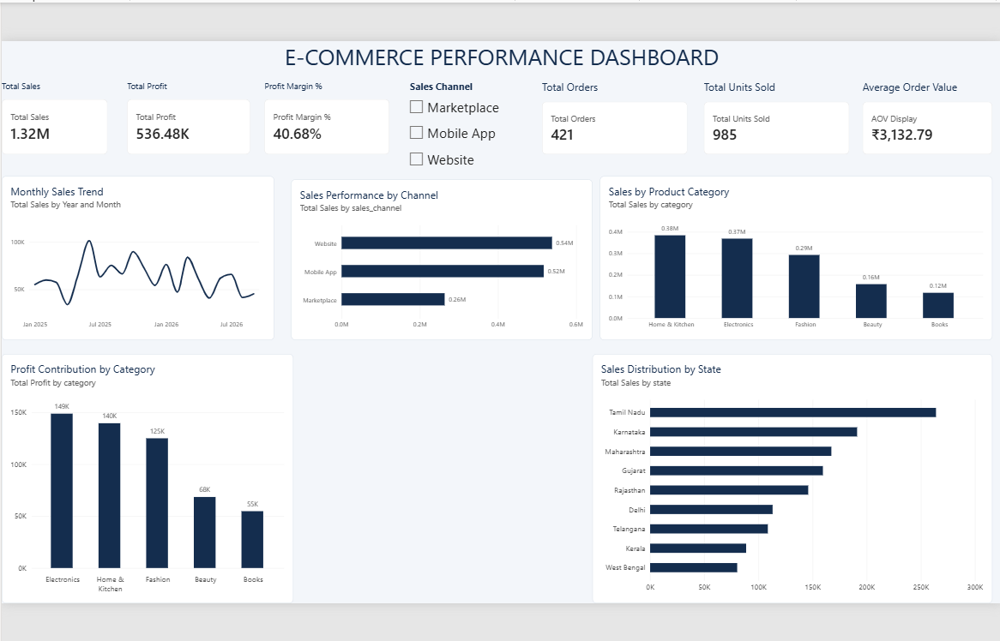

# E-Commerce Performance Analysis

## Project Overview
An end-to-end E-Commerce Performance Analysis project built using **Microsoft Excel, MySQL, and Power BI**. The project analyzes sales, profit, products, customers, orders, and payment performance to generate meaningful business insights.

## Tools & Technologies
- **Microsoft Excel:** Data exploration and preparation
- **Power Query:** Data cleaning and transformation
- **MySQL:** Data storage, validation, and SQL analysis
- **Power BI:** Data modeling, DAX measures, and interactive dashboards

## Dataset
This project uses a **synthetic e-commerce dataset** containing five tables:

| Table | Records |
|---|---:|
| Customers | 220 |
| Products | 18 |
| Orders | 650 |
| OrderItems | 1,154 |
| Payments | 650 |

## Dashboard Pages
1. **Executive Overview** – Overall sales, profit, margin, orders, and sales trends.
2. **Sales Performance** – Monthly sales and profit trends, category and state analysis.
3. **Product Analysis** – Product revenue, profit, units sold, discounts, and sales distribution.
4. **Customer Insights** – Customer segmentation, revenue contribution, and geographical analysis.
5. **Orders & Payments** – Order status, payment status, payment methods, and transaction amounts.

## Key Business Insights
- Delivered-order revenue: **₹1,318,905.50**
- Delivered-order profit: **₹536,475.50**
- Profit margin: **40.68%**
- Delivered orders: **421**
- Units sold: **985**
- Average order value: **₹3,132.79**
- Repeat customers: **123**

## SQL Analysis
SQL queries were used for:
- Data validation and record-count checks
- Sales and profit calculations
- Category and product performance
- Sales channel and state analysis
- Customer segmentation
- Order and payment status analysis

## Project Structure
The `e COMMERCE PROJECT` folder contains the dataset files, Excel workbook, Power BI report, and SQL scripts.

## Project Objective
To demonstrate practical data analyst skills, including data cleaning, SQL querying, data modeling, DAX calculations, dashboard development, and business insight generation.

---

**Note:** This project uses synthetic data for learning and portfolio demonstration.
## Dashboard Preview

### Executive Overview

